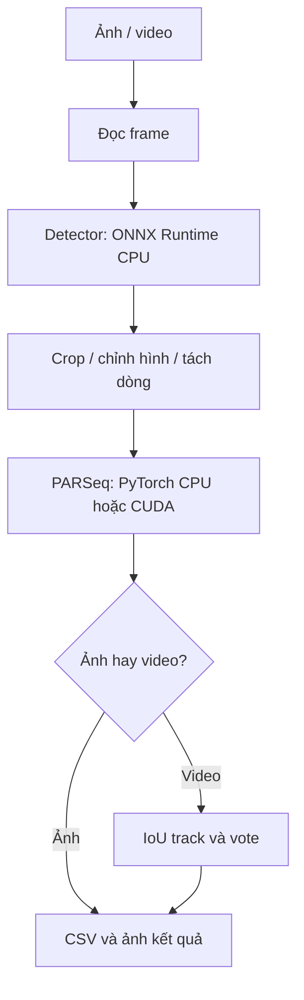

# 00 — Đọc bản đồ trước khi sửa hệ thống

## Bài toán thực sự

Ảnh toàn cảnh chứa xe, biển và nền. PARSeq nhận dạng chuỗi từ vùng chữ; nó không tự tìm biển trong toàn cảnh. Vì vậy ứng dụng cần cả detector, xử lý ảnh và logic video/CSV.

Một output sai có thể do vùng biển sai, cắt mất chữ, tách dòng sai, OCR sai hoặc vote sai. Không mặc định mọi lỗi đều do weights PARSeq.

## Luồng đang có

Trong `alpr_auto.py`, `--device cuda` chỉ chọn GPU cho PARSeq. Detector của baseline vẫn dùng CPU. Các file CSV không tự là nhãn đúng.

## Đọc code theo ranh giới

| Câu hỏi | File/hàm cần đọc |
| --- | --- |
| Ảnh được đọc/các video được duyệt thế nào? | [alpr_auto.py](../alpr_auto.py): `input_sources`, `frames` |
| Tensor detector được tạo thế nào? | `letterbox`, `PlateDetector.predict` |
| Output detector đổi về tọa độ gốc thế nào? | `decode_boxes` |
| Biển nghiêng và hai dòng được xử lý ở đâu? | `rectify_plate`, `line_regions` |
| OCR chạy và giải mã ở đâu? | `ParseqReader.read` |
| Gộp kết quả video ở đâu? | `PlateTracks.update`, `PlateTracks.event` |
| Batch crop tính metrics thế nào? | [ocr_batch.py](../ocr_batch.py): `make_row`, `summarize` |
| Encoder được thay bằng ORT để đối chiếu ở đâu? | [export_parseq_encoder.py](../export_parseq_encoder.py): `onnx_encode` |

## Đường đi dữ liệu là hợp đồng

Tại mỗi ranh giới, ghi 5 thuộc tính: shape, dtype, layout, miền giá trị và device.

| Ranh giới | Ví dụ ở cấu hình hiện tại |
| --- | --- |
| Frame OpenCV | H×W×3, uint8, BGR, 0…255, RAM CPU |
| Input detector mặc định | 1×3×640×640, float32, RGB/NCHW, 0…1, CPU |
| Bbox sau decode | x1,y1,x2,y2 theo ảnh gốc, giới hạn trong ảnh |
| Input PARSeq mặc định | 1×3×32×128, float32, RGB/NCHW, khoảng −1…1 |
| Encoder PARSeq mặc định | 1×128×384, float32; không phải chuỗi ký tự |
| Chuỗi OCR | Tokenizer dừng ở EOS; lưu raw và normalized theo công cụ |

Các kích thước chỉ đúng với cấu hình/weights đang dùng. Khi thay model phải kiểm tra lại; không hard-code vì nhớ một bảng.

## Luồng dự kiến với NPU

PyTorch → export encoder ONNX → DX-COM → .dxnn → DX-RT → feature → decoder.

Đây là mục tiêu cần thử, chưa phải backend ALPR đã có. NPU cần nhận buffer đúng hợp đồng; decoder CPU/GPU không thể dùng trực tiếp dữ liệu có layout khác chỉ vì số phần tử giống nhau.

## Thực hành và tự kiểm tra

Chọn một ảnh toàn cảnh của nhóm, liệt kê các vật trung gian cần lưu để biết chữ sai ở bước nào: frame gốc, bbox, crop, từng dòng, tensor metadata, raw OCR, event cuối. Lưu vật trung gian vào `results/` đã ignore.

Giải thích:
1. Vì sao MobileNetV2 chạy NPU được chưa chứng minh PARSeq chạy được?
2. Vì sao CSV có 10 events chưa chứng minh có 10 xe?
3. Vì sao encoder ONNX PASS nhưng OCR vẫn có thể sai?

Đạt yêu cầu khi chỉ được bước cần kiểm tra trước cho mỗi hiện tượng, không chỉ trả lời “do AI”.
